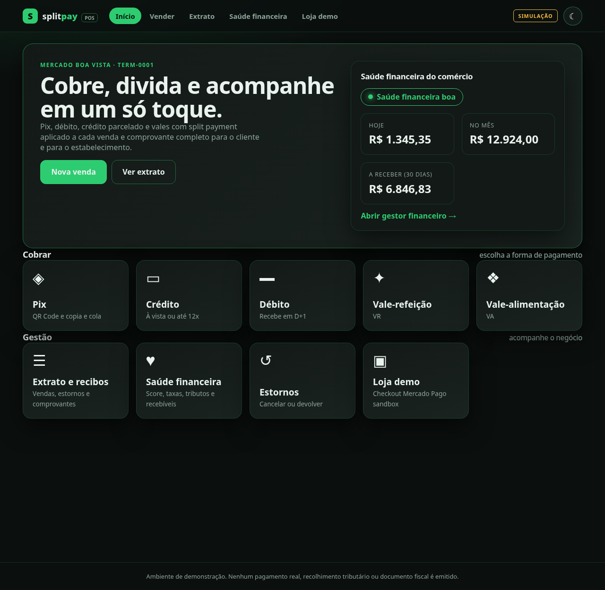
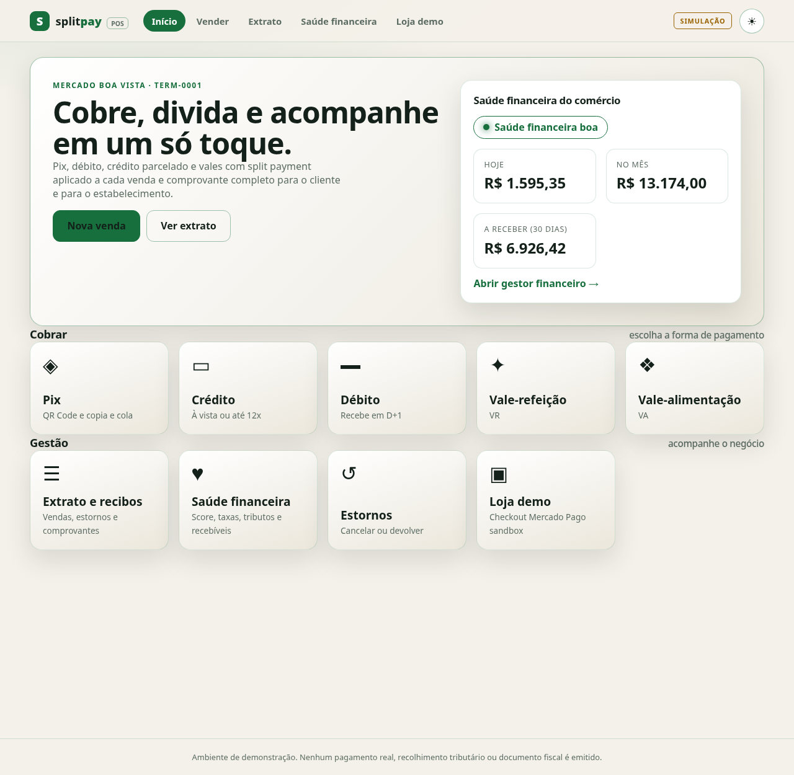
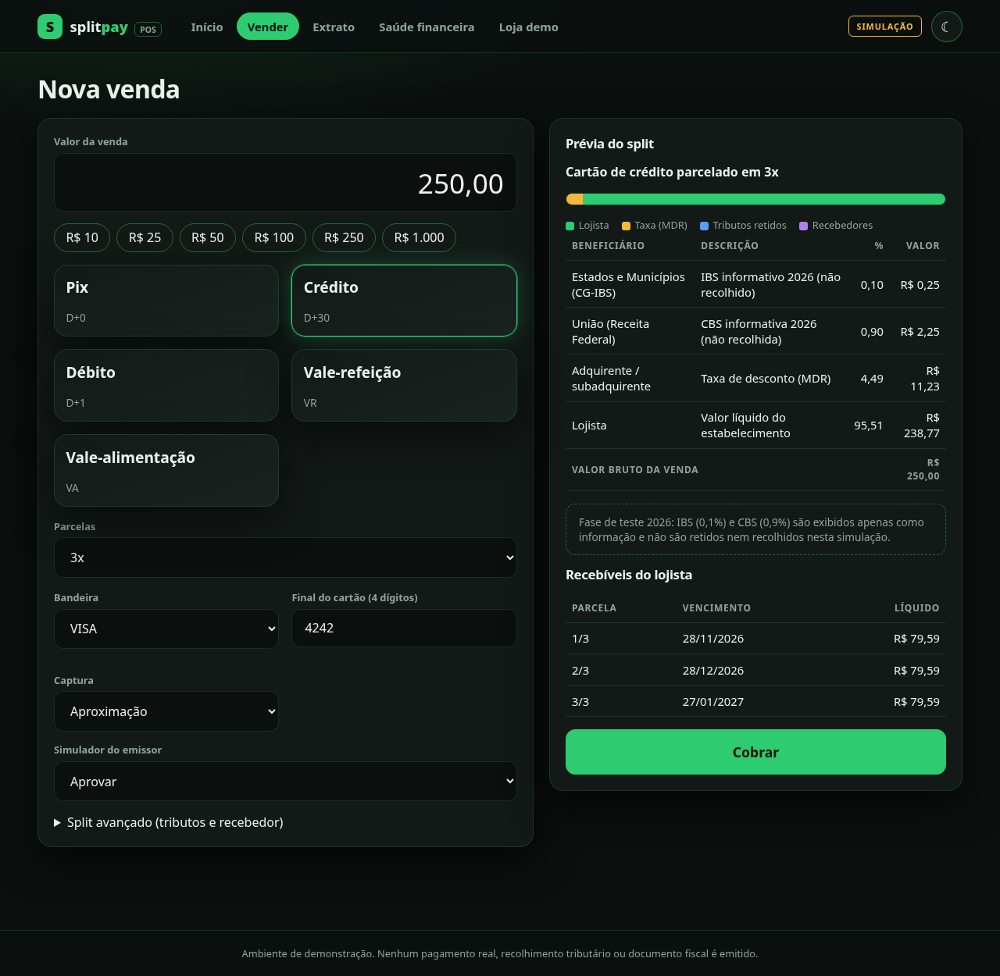
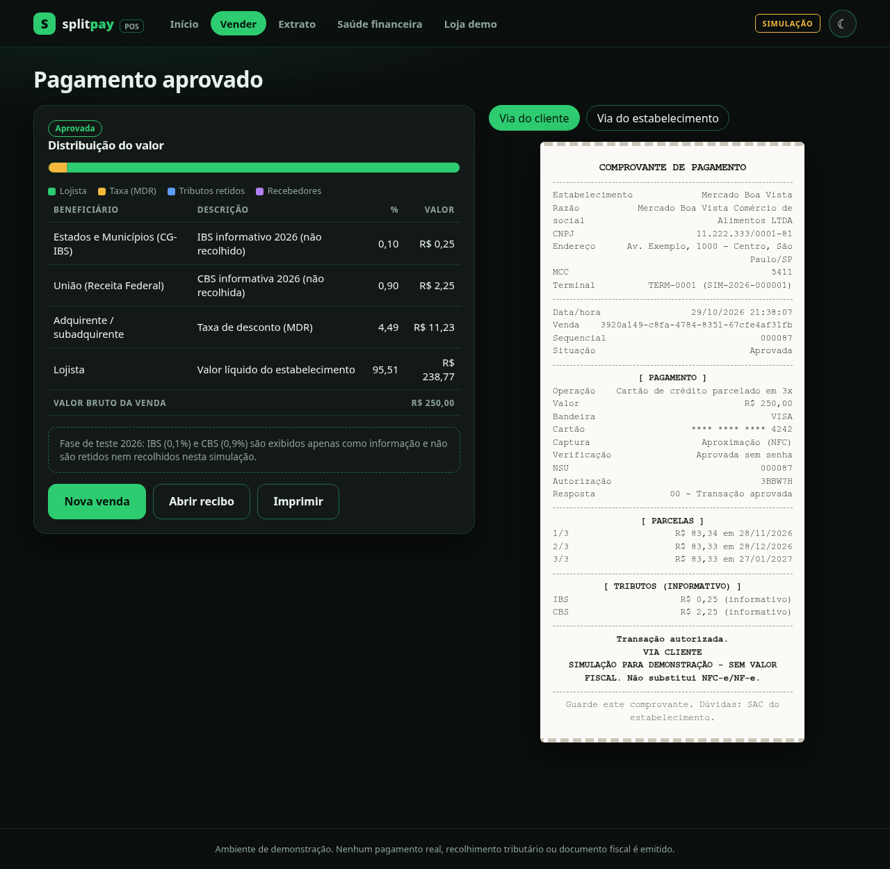
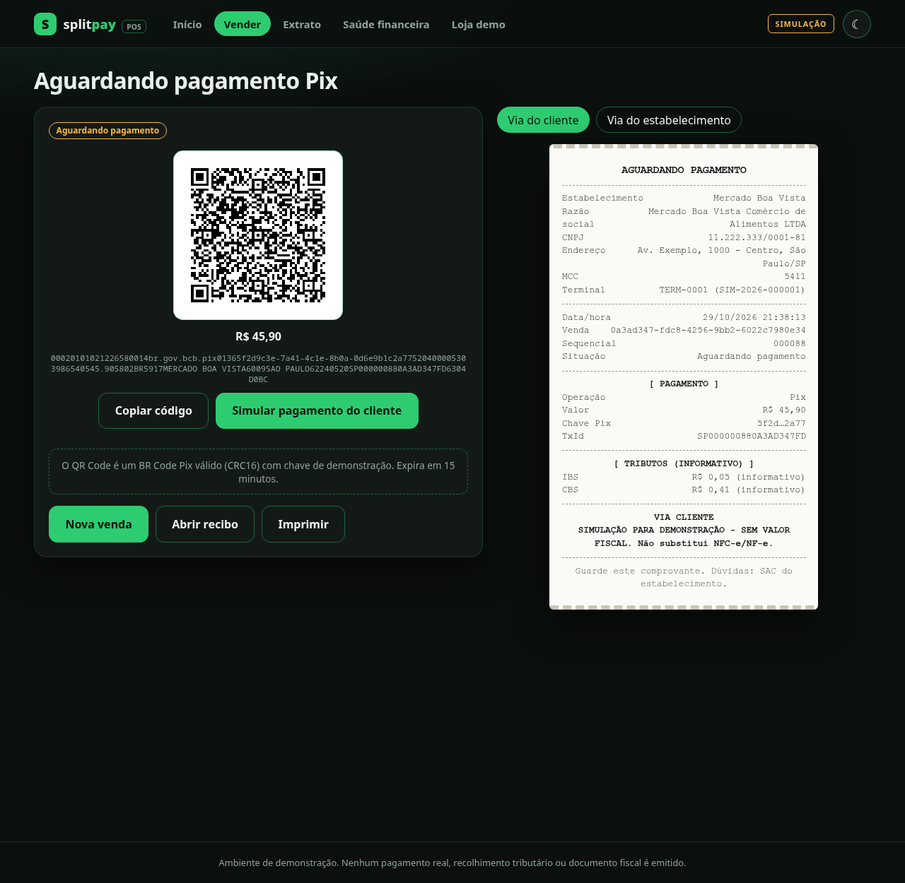
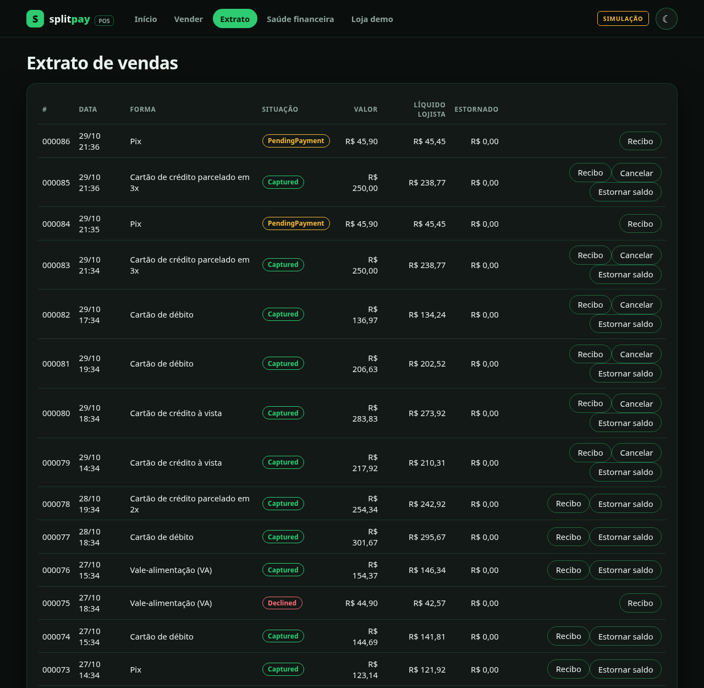
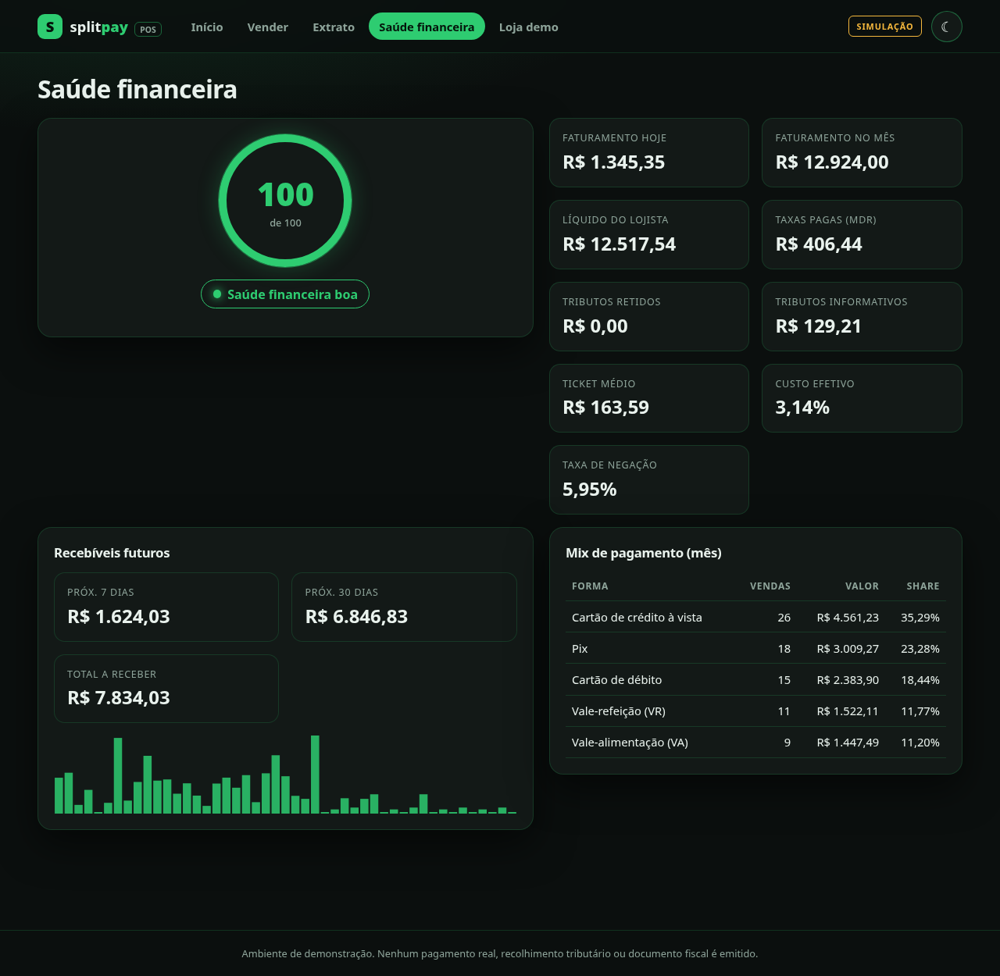
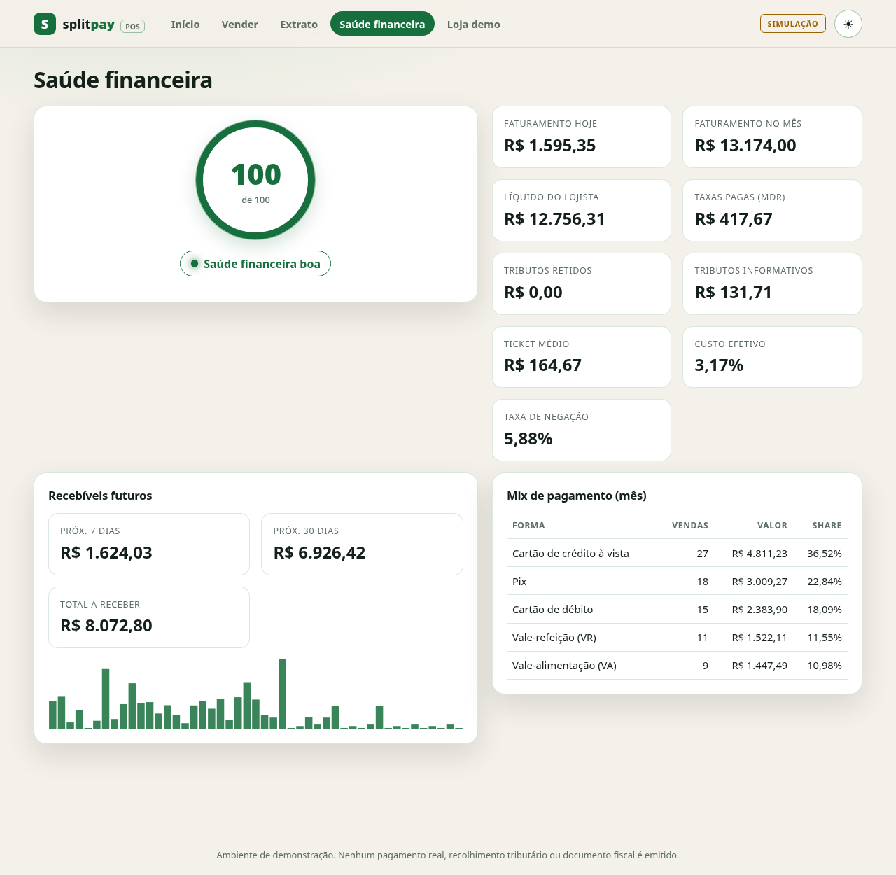
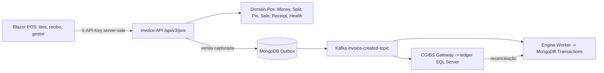
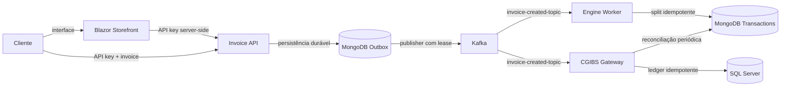

# SplitPay POS

[](LICENSE)

Simulador de **maquininha de pagamento brasileira** com **split payment** aplicado a cada venda, **recibo (comprovante) completo** e um **micro gestor financeiro** que devolve ao terminal a saúde financeira do comércio.

> **Projeto base:** [split-payment-platform](https://github.com/VniiD/split-payment-platform) — a fundação (pipeline de eventos, checkout demo, Mercado Pago sandbox) que originou este projeto.
>
> **Origem.** Este repositório é a junção de dois projetos: o **SplitPay** (plataforma de split payment com API .NET, Kafka, MongoDB, SQL Server e storefront Blazor, documentada na seção [Plataforma base](#plataforma-base-split-payment-platform-splitpay)) e o novo módulo **POS**, que o transforma em um sistema de pagamento de ponta a ponta. As vendas capturadas no POS alimentam o mesmo pipeline *outbox → Kafka → Engine → ledger CG-IBS* do SplitPay.
>
> **Simulação técnica.** Não realiza pagamentos reais, recolhimento tributário, liquidação nem emissão de documento fiscal. Não é um adquirente, não é certificado (PCI-PTS, EMV, ABECS) e as taxas são ilustrativas. Os recibos trazem o aviso "sem valor fiscal".

**Autor:** [VniiD](https://github.com/VniiD) · **Licença:** [GNU GPL-3.0-only](LICENSE)

## Telas

Tema escuro (grafite com contornos verdes) e tema claro, com tiles grandes para cada função.

| | |
|---|---|
| <br>**Início** — tiles por forma de pagamento e resumo de saúde financeira | <br>**Início no tema claro** |
| <br>**Nova venda** — crédito 3x com prévia do split | <br>**Aprovação e recibo** — split e comprovante de 40 colunas |
| <br>**Pix** — BR Code com copia e cola | <br>**Extrato** — recibos, cancelamento e estorno |
| <br>**Saúde financeira** — score, recebíveis e mix de pagamento | <br>**Saúde financeira no tema claro** |

*Os dados das capturas são de demonstração (histórico de 28 dias gerado pelo próprio sistema).*

## O que o POS entrega

| Capacidade | Como funciona |
|---|---|
| **Pix / QR Code** | Gera um *BR Code* EMV real ("copia e cola" + QR em SVG) com CRC16-CCITT, valor, TxId e validade de 15 min. O pagamento do cliente é simulado e gera `EndToEndId`. |
| **Débito, crédito e parcelado** | Crédito à vista ou de 2x a 12x (parcela mínima R$ 5,00). Autorização simulada com NSU, código de autorização e códigos de resposta ISO 8583 (00, 05, 51, 54). Só os 4 últimos dígitos do cartão são aceitos e guardados. |
| **Vale-refeição e vale-alimentação** | Bandeiras ALELO, SODEXO, VR e TICKET, com taxa e liquidação próprias. |
| **Split payment** | Cada venda é dividida em: IBS, CBS, taxa do adquirente (MDR), até 5 recebedores adicionais e líquido do lojista. A soma das linhas sempre fecha com o valor bruto (testado por propriedade). |
| **Tributos** | Modo `Informative2026`: IBS 0,1% e CBS 0,9% informativos, não retidos (fase de teste de 2026). Modo `SimulatedRetention`: simula a retenção no ato da venda. |
| **Recebíveis** | Cronograma por parcela com valores exatos em centavos (maior resto): Pix D+0, débito D+1, crédito e vales D+30 por parcela. |
| **Estado da venda** | Máquina de estados: pendente, capturada, negada, expirada, cancelada, parcialmente estornada e estornada. Cancelamento só no mesmo dia; Pix exige estorno (devolução). Trilha de auditoria por venda. |
| **Recibo** | Via do cliente e via do estabelecimento, em JSON e texto de 40 colunas. Ver [Recibo](#recibo-comprovante). |
| **Gestor financeiro** | Faturamento do dia e do mês, líquido, taxas, tributos, ticket médio, mix de pagamento, estornos, taxa de negação, recebíveis futuros e **score 0 a 100** (verde, amarelo ou vermelho). |
| **Front** | Tiles grandes estilo streaming, tema **escuro** (grafite com contornos verdes) e **claro** (papel quente com verde-floresta), alternável e persistido. |

## Arquitetura



- **`SplitPayment.Domain/Pos`**: regras puras e testáveis, sem I/O. `Money` em centavos (`long`), `SplitEngine`, `FeeSchedule`, `ReceivableScheduler`, `PixBrCode`, `CardAuthorizer`, `Sale`, `ReceiptBuilder`, `FinancialHealthCalculator` e os contratos compartilhados entre API e Web.
- **`SplitPayment.InvoiceApi/Pos`**: `PosService` (orquestração, idempotência, ledger), `PosStore` e `PosEndpoints`.
- **`SplitPayment.Web`**: páginas `/` (tiles), `/pos/venda`, `/pos/extrato`, `/pos/recibo/{id}`, `/pos/saude` e a loja demo em `/loja`.

## API do POS

Todas as rotas exigem `X-API-Key`. A criação de venda exige também `Idempotency-Key` (8 a 128 caracteres). Repetir a chave e o corpo devolve a mesma venda (`200`); reutilizar a chave com outro corpo devolve `409`. A especificação OpenAPI está em `/openapi/v1.json`.

| Método e rota | Função |
|---|---|
| `GET /api/v3/pos/catalog` | Formas de pagamento, bandeiras e tabela de taxas de demonstração |
| `GET /api/v3/pos/merchants` | Lojistas e terminais |
| `POST /api/v3/pos/sales/preview` | Simula split e recebíveis sem criar a venda |
| `POST /api/v3/pos/sales` | Cria a venda (autoriza o cartão ou gera o Pix) |
| `POST /api/v3/pos/sales/{id}/pix/confirm` | Simula o pagamento do Pix pelo cliente |
| `POST /api/v3/pos/sales/{id}/cancel` | Cancela no mesmo dia (cartão) |
| `POST /api/v3/pos/sales/{id}/refunds` | Estorno total ou parcial |
| `GET /api/v3/pos/sales/{id}` | Detalhe da venda |
| `GET /api/v3/pos/sales/{id}/receipt?via=customer\|merchant&format=json\|text` | Recibo |
| `GET /api/v3/pos/merchants/{id}/sales` | Últimas vendas |
| `GET /api/v3/pos/merchants/{id}/health` | Gestor financeiro |
| `POST /api/v3/pos/merchants/{id}/demo-history` | Gera 28 dias de histórico determinístico |

Exemplo (crédito em 3x com recebedor adicional de 10% e retenção simulada de tributos):

```bash
curl -X POST http://localhost:5080/api/v3/pos/sales \
  -H "X-API-Key: $API_KEY" -H "Idempotency-Key: venda-0001-demo" \
  -H "Content-Type: application/json" \
  -d '{
    "method": "Credit", "amountCents": 25000, "installments": 3,
    "card": { "brand": "VISA", "last4": "4242", "entryMode": "Contactless" },
    "taxMode": "SimulatedRetention",
    "recipients": [{ "name": "Fornecedor X", "taxId": "11222333000181", "basisPoints": 1000 }]
  }'
```

Para simular uma negação, envie `"simulateOutcome": "InsufficientFunds"` (`DoNotHonor` e `ExpiredCard` também existem).

### Recibo (comprovante)

O recibo segue o layout usual de comprovantes de maquininha no Brasil:

- **Estabelecimento**: nome fantasia, razão social, CNPJ, endereço, MCC e terminal.
- **Transação**: data e hora, identificador da venda, sequencial e situação.
- **Pagamento**: operação (Pix, débito, crédito à vista ou parcelado, VR, VA), valor, bandeira, cartão mascarado (`**** **** **** 1234`), modo de captura, verificação por senha, **NSU**, **código de autorização** e resposta do emissor. Para Pix, chave mascarada, TxId, EndToEndId e pagador.
- **Parcelas**: número, valor e vencimento.
- **Via do cliente**: mostra apenas tributos informativos. **Via do estabelecimento**: mostra o split completo (taxa, tributos, recebedores e líquido).
- **Negada ou expirada**: título "TRANSAÇÃO NEGADA" ou "COBRANÇA PIX EXPIRADA" e aviso de que nenhum valor foi cobrado.
- **Rodapé**: "SIMULAÇÃO PARA DEMONSTRAÇÃO - SEM VALOR FISCAL. Não substitui NFC-e/NF-e."

> Os campos acima são os usuais do mercado, mas este projeto **não afirma conformidade** com normas do Banco Central, da ABECS ou dos adquirentes. Um comprovante real depende do adquirente e da certificação do terminal.

### Gestor financeiro e score

O score parte de 100 e perde pontos por: estornos acima de 2% ou 5% do mês, custo efetivo de taxas acima de 3,5% ou 4,5%, negações acima de 10% ou 20%, queda de faturamento de 10% ou 30% frente à semana anterior, mais de 60% dos recebíveis vencendo após 30 dias e ausência de vendas nos últimos 7 dias. Verde: 75 ou mais. Amarelo: 50 a 74. Vermelho: abaixo de 50. Com menos de 5 vendas no mês o indicador é marcado como de baixa confiança.

### Taxas de demonstração

| Forma | MDR | Liquidação |
|---|---|---|
| Pix | 0,99% | D+0 |
| Débito | 1,99% | D+1 |
| Crédito à vista | 3,49% | D+30 |
| Crédito 2x a 6x | 4,49% | D+30 por parcela |
| Crédito 7x a 12x | 4,99% | D+30 por parcela |
| VR e VA | 5,20% | D+30 |

## Executar localmente

Sem Docker (somente o POS, sem Kafka nem MongoDB; as vendas não são enviadas ao ledger):

```bash
export KEY=troque-por-uma-chave-local-com-32-ou-mais-caracteres
Security__ApiKey=$KEY Mongo__ConnectionString=mongodb://localhost:27017 \
  Testing__DisableOutboxPublisher=true Pos__LedgerSink=None \
  ASPNETCORE_URLS=http://localhost:5080 ASPNETCORE_ENVIRONMENT=Development \
  dotnet run --project src/SplitPayment.InvoiceApi --no-launch-profile

Backend__ApiKey=$KEY Backend__BaseUrl=http://localhost:5080/ \
  ASPNETCORE_URLS=http://localhost:5090 ASPNETCORE_ENVIRONMENT=Development \
  dotnet run --project src/SplitPayment.Web --no-launch-profile
```

Abra `http://localhost:5090`. Na tela inicial, use "Carregar histórico demo" para popular o gestor financeiro.

Com a stack completa (MongoDB, Kafka, SQL Server, workers), siga a seção [Execução local totalmente containerizada](#execução-local-totalmente-containerizada). Nesse modo, cada venda capturada é enfileirada no outbox com `Id = pos-sale-{saleId}` e processada pelos workers existentes.

Testes: `dotnet test SplitPayment.sln` (os testes do POS não exigem Docker).

## Maturidade e limites conhecidos

**Validado em Docker Compose:** a stack completa (SQL Server, Kafka, MongoDB, API, Engine Worker, CGIBS Gateway, storefront) sobe saudável; uma venda POS em crédito 3x foi capturada, gravada no outbox, publicada no Kafka (`Published`) e consumida pelo Engine Worker (`Split persisted for invoice …`).

**Já sólido:** domínio puro e coberto por testes (incluindo teste de propriedade do split), aritmética em centavos, idempotência HTTP, máquina de estados, BR Code Pix com CRC validado, PAN nunca armazenado, rate limit, autenticação por chave com comparação em tempo constante, CSP restritiva no front, CI e Docker.

**Para levar a produção (não implementado):**

1. **Persistência durável do POS.** `PosStore` é em memória; as vendas somem ao reiniciar. Trocar por MongoDB/SQL (a interface de uso já está isolada em `PosStore`/`PosService`).
2. **Reenvio ao ledger.** Se o MongoDB estiver indisponível na captura, a venda segue válida e a trilha registra `ledger.deferred`, mas não há reprocessamento automático.
3. **Identidade e acesso.** Hoje há uma única chave de API. Falta autenticação por operador e terminal, RBAC e auditoria imutável.
4. **Adquirência real.** Falta integração com adquirente/PSP, tokenização, 3-D Secure, conciliação e tratamento de chargeback. Um terminal real exige certificação (PCI-PTS, EMV L1/L2/L3) e conformidade PCI DSS e LGPD.
5. **Fiscal.** Sem emissão de NFC-e/NF-e e sem classificação fiscal (NCM, CST, cClassTrib). O split de tributos é uma simulação.
6. **Antecipação de recebíveis, multi-lojista e multi-terminal** (há um lojista e um terminal de demonstração).
7. **Observabilidade.** Faltam OpenTelemetry, métricas e alertas.
8. **Testes.** Faltam testes e2e do front, de carga e a automação no CI do fluxo POS com Kafka (verificado manualmente no compose).

---

## Plataforma base: Split Payment Platform (SplitPay)

[](LICENSE)

Plataforma demonstrativa com storefront Blazor, API .NET, Kafka, MongoDB e SQL Server. Inclui processamento assíncrono de invoices, checkout local totalmente simulado e integração hospedada Mercado Pago restrita a credenciais de teste.

**Autor:** [VniiD](https://github.com/VniiD)
**Licença:** [GNU GPL-3.0-only](LICENSE)

> **Simulação técnica.** Este software não realiza pagamentos reais, recolhimento tributário oficial ou emissão de documento fiscal. Checkout Pro opera apenas em sandbox com token `TEST-`. O endpoint `/api/v2/demo/tax-calculations` reproduz valores informativos de teste de IBS/CBS divulgados para 2026; não representa apuração tributária nem recolhimento. O endpoint legado de invoices continua usando alíquotas fornecidas pelo cliente e também não é cálculo fiscal oficial.

### Arquitetura



| Componente | Responsabilidade |
|---|---|
| `SplitPayment.Web` | Checkout responsivo em Blazor Interactive Server; mantém a chave da API no servidor e oferece simulador local ou checkout hospedado de sandbox |
| `SplitPayment.InvoiceApi` | Autenticação por `X-API-Key`, validação, rate limit, idempotência HTTP, checkout mock local ou checkout sandbox e consulta de status |
| MongoDB `InvoiceOutbox` | Aceite durável, hash da requisição e fila de publicação com lease e retry limitado |
| Kafka | Evento versionado `InvoiceCreatedEvent`, chaveado por CNPJ do fornecedor |
| `SplitPayment.EngineWorker` | Calcula o split e grava em `Transactions` com `InvoiceId` único |
| `SplitPayment.CgibsGateway` | Grava o ledger SQL e compara periodicamente os dois destinos |

A entrega é *at-least-once*. Uma falha entre a confirmação do Kafka e a atualização do outbox pode publicar novamente; os consumidores tornam o efeito de persistência idempotente por `InvoiceId`. Cada consumer usa seu próprio grupo e DLQ.

### API

#### Cálculo demonstrativo IBS/CBS 2026

`POST /api/v2/demo/tax-calculations` exige `X-API-Key` e recebe:

```json
{
  "taxBase": 1000.00,
  "referenceDate": "2026-10-28"
}
```

O perfil fixo `BR-RTC-2026-TEST-1` simula uma base sintética para demonstrar as alíquotas-teste de `0,1%` de IBS e `0,9%` de CBS. Para uma base fictícia de R$ 1.000,00, retorna R$ 1,00 e R$ 9,00 como valores informativos. A resposta declara `taxBaseIsSynthetic: true`, `fiscalClassificationValidated: false` e `paymentOrTaxCollectionExecuted: false`. Ela não calcula o repasse do fornecedor. Identifica a competência geral do IBS como compartilhada entre Estados e Municípios, sem ratear o valor por ente federativo, e a CBS como federal.

Esse perfil aceita apenas datas de 2026 e bases positivas em centavos. O chamador informa diretamente a base sintética; ela não é inferida do preço de venda nem validada como base fiscal. A classificação do produto (NCM), a situação da operação (CST/cClassTrib), exceções, créditos, destino, obrigação acessória, eventual condição para dispensa de recolhimento, arredondamento fiscal, emissão de documento fiscal, integração com PSP e liquidação não fazem parte da simulação. A dispensa de recolhimento em 2026 depende do cumprimento das obrigações acessórias aplicáveis; este endpoint não avalia esse cumprimento. O campo de data apenas limita a versão demonstrativa selecionada e não determina se uma operação real está enquadrada. Os dados e o arredondamento são sintéticos e não devem ser usados para escrituração ou decisão tributária.

Fontes oficiais usadas para delimitar o exemplo:

- [CGIBS — campos de IBS/CBS, alíquotas de teste e caráter informativo em 2026](https://cgibs.gov.br/novo-marco-da-reforma-tributaria-inicia-em-03-de-agosto-com-preenchimento-obrigatorio-dos-campos-relativos-ao-ibs-e-a-cbs)
- [Receita Federal — fase de testes da Reforma Tributária do Consumo em 2026](https://www.gov.br/receitafederal/pt-br/assuntos/noticias/2026/janeiro/fazenda-receita-e-serpro-lancam-reforma-tributaria-do-consumo-em-cerimonia-em-brasilia)
- [Ato Conjunto RFB/CGIBS nº 1/2025 — obrigações acessórias e dispensa condicionada](https://www.in.gov.br/web/dou/-/ato-conjunto-rfb/cgibs-n-1-de-22-de-dezembro-de-2025-677624586)
- [Receita Federal — documentação técnica da Plataforma Pública do Split Payment](https://www.gov.br/fazenda/pt-br/assuntos/noticias/2026/junho/receita-federal-e-comite-gestor-do-ibs-publicam-documentacao-tecnica-da-plataforma-publica-do-split-payment)

O split payment oficial não é executado por este endpoint. A documentação da Receita Federal destina a integração da Plataforma Pública às instituições operadoras de sistemas de pagamento e prestadores de serviços de pagamento eletrônico.

Não há classificação genérica oficial que permita atribuir NCM, CST ou cClassTrib apenas por chamar um item de “mercadoria comum”. Uma aplicação real deve usar a versão vigente do leiaute e das tabelas oficiais para cada documento e operação, com classificação validada por profissional fiscal. Em 28/10/2026, o [Ato Técnico Conjunto nº 8/2026 do CGIBS](https://www.cgibs.gov.br/upload/arquivos/202610/01120217-nfe-nfc-cte-notas-faturas-e-demais-atc-rfb-sufis-cgibs-diretoria-executiva-n-8-de-29-de-setembro-de-2026.pdf) aprovou versões atuais da NT 2025.002 e do Informe Técnico 2025.002 para NF-e/NFC-e; esse endpoint não implementa esses leiautes.

#### Contrato legado de invoice

`POST /api/v1/invoices` exige os headers:

| Header | Regra |
|---|---|
| `X-API-Key` | Chave configurada fora do código; comparação em tempo constante |
| `Idempotency-Key` | 8 a 128 caracteres ASCII alfanuméricos, `.`, `_` ou `-` |

Corpo:

```json
{
  "merchantTaxId": "11.222.333/0001-81",
  "customerTaxId": "529.982.247-25",
  "grossAmount": 1000.00,
  "ibsRate": 17.7,
  "cbsRate": 8.8,
  "isSimplifiedProcedure": false
}
```

Este contrato é mantido para compatibilidade com o fluxo demonstrativo já existente. As alíquotas enviadas no corpo são configuradas pelo chamador e não representam regras tributárias oficiais; não misture seus valores com o endpoint fiscal demonstrativo acima.

`202 Accepted` significa que o evento foi gravado no outbox com write concern majority; a publicação Kafka pode ainda estar pendente. Repetir a mesma chave e conteúdo retorna o mesmo `invoiceId`; reutilizar a chave com conteúdo diferente retorna `409`. A rota `GET /api/v1/invoices/{invoiceId}` consulta o estado e exige a mesma chave de API.

- `400`: documento, valor, alíquota ou chave de idempotência inválida.
- `401`: chave de API ausente ou inválida.
- `409`: chave de idempotência reutilizada com outro conteúdo.
- `429`: limite de 30 requisições por minuto por IP.
- `503`: não foi possível aceitar a invoice duravelmente.

OpenAPI: `GET /openapi/v1.json`. Health checks: `GET /health/live` e `GET /health/ready`; readiness verifica MongoDB e Kafka.

#### Checkout sandbox do Mercado Pago

A API inclui um fluxo de demonstração usando o **Checkout Pro hospedado**. O catálogo sintético expõe um produto fixo (`demo-item-001`, R$ 49,90); o preço é definido no servidor. O comprador é redirecionado para a URL `sandbox_init_point` e escolhe os meios disponíveis no checkout do Mercado Pago, incluindo Pix e cartão conforme a conta de teste. A aplicação não coleta nem armazena número do cartão ou CVV.

- `GET /api/v2/demo/products`: lista os produtos sintéticos.
- `POST /api/v2/demo/checkouts`: cria preferência sandbox; exige `X-API-Key` e `Idempotency-Key`, com `productId` e `quantity` (1 a 10).
- `GET /api/v2/demo/checkouts/{checkoutId}`: consulta o status; exige `X-API-Key`.
- `POST /webhooks/mercadopago/payments`: recebe notificações de pagamento; valida `x-signature`, busca o pagamento pela API do provedor e confere modo sandbox, referência externa, moeda e valor antes de persistir o status.

Esse fluxo **não realiza pagamento real, não calcula tributos, não emite documento fiscal e não participa da Plataforma Pública de Split Payment**. Um checkout criado não significa pagamento aprovado; considere o pagamento confirmado somente quando o status obtido do provedor indicar `approved`. As credenciais de teste precisam começar com `TEST-`; tokens de produção não habilitam o cliente.

#### Simulador local de pagamento

O Compose usa `ASPNETCORE_ENVIRONMENT=LocalTesting` e `DEMO_PAYMENTS_MODE=Mock` por padrão. Nesse modo, a API cria (ou atualiza de forma idempotente) dois perfis fictícios na coleção `DemoTestProfiles`, com emails reservados `comprador@example.test` e `compradora@example.test`. Eles não têm senha, não autenticam pessoas e não são contas do Mercado Pago.

Na loja, selecione um perfil, produto e quantidade. O botão de checkout abre uma tela de simulação onde é possível registrar `approved`, `rejected` ou manter o status `pending`. Os checkouts são persistidos em `DemoPaymentCheckouts`; nenhum request é enviado a um provedor de pagamentos.

- `GET /api/v2/demo/test-profiles`: lista perfis fictícios apenas no modo local.
- `POST /api/v2/demo/checkouts`: aceita também `testProfileId` no modo mock; continua exigindo `X-API-Key` e `Idempotency-Key`.
- `POST /api/v2/demo/checkouts/{checkoutId}/mock-payment`: registra o resultado local escolhido (`approved`, `rejected` ou `pending`); disponível apenas em `LocalTesting` + `Mock`.

O mock é desabilitado fora do ambiente `LocalTesting`; uma tentativa de iniciar a API em outro ambiente com `DEMO_PAYMENTS_MODE=Mock` falha explicitamente. A consulta do checkout continua sendo feita à API e o parâmetro de retorno do browser não define o resultado.

#### Storefront Blazor

O projeto `SplitPayment.Web` entrega uma interface de checkout responsiva para desktop, tablet e celular. A página de retorno consulta o status persistido pela API; o parâmetro de retorno enviado pelo navegador não é tratado como confirmação de pagamento. A chave `X-API-Key` é adicionada pelo cliente HTTP server-side e não é enviada ao navegador. A tela exibe apenas produto sintético e avisa que o checkout não emite nota fiscal nem realiza cobrança real.

Com a stack Docker iniciada, abra `http://localhost:5081`. Para executar somente o storefront fora do Compose, forneça uma chave local com no mínimo 32 caracteres e mantenha a API disponível em `http://localhost:5080`:

```bash
Backend__ApiKey='chave-local-de-desenvolvimento-com-32-caracteres' \
  dotnet run --project src/SplitPayment.Web
```

O endereço da API pode ser alterado por `Backend__BaseUrl`; em produção, publique o storefront e a API com HTTPS e injete a chave por um gestor de segredos. No Compose, `STOREFRONT_PUBLIC_BASE_URL` deve ser o endereço acessível pelo navegador, pois o provedor usa essa URL para os retornos do checkout.

Para usar o Mercado Pago sandbox em vez do simulador local:

1. Crie uma aplicação e credenciais de teste no painel do Mercado Pago Developers e configure notificações de pagamento para obter a chave secreta de webhook. As [instruções oficiais de compras de teste](https://www.mercadopago.com.br/developers/pt/docs/checkout-pro-preferences/integration-test/test-purchases) explicam usuários compradores e cartões de teste.
2. Disponibilize a API local por um túnel HTTPS sob seu controle (por exemplo, uma URL de desenvolvimento temporária) e configure essa URL com o caminho `/webhooks/mercadopago/payments`. O provedor precisa conseguir acessar o endpoint; `localhost` não é acessível a ele.
3. Configure os segredos **fora do código**. Para execução local com `dotnet run`, use User Secrets:

```bash
dotnet user-secrets set --project src/SplitPayment.InvoiceApi "MercadoPago:Mode" "Sandbox"
dotnet user-secrets set --project src/SplitPayment.InvoiceApi "MercadoPago:AccessToken" "TEST-..."
dotnet user-secrets set --project src/SplitPayment.InvoiceApi "MercadoPago:WebhookSecret" "<segredo do webhook>"
dotnet user-secrets set --project src/SplitPayment.InvoiceApi "MercadoPago:NotificationUrl" "https://<seu-host-publico>/webhooks/mercadopago/payments"
```

Para Docker Compose, use as variáveis `MERCADOPAGO_MODE=Sandbox`, `MERCADOPAGO_ACCESS_TOKEN`, `MERCADOPAGO_WEBHOOK_SECRET` e `MERCADOPAGO_NOTIFICATION_URL` no `.env` local ignorado pelo Git. Defina também `DEMO_PAYMENTS_MODE=Disabled` para que o checkout use o provedor. O modo do Mercado Pago continua `Disabled` por padrão; se o token não for de teste ou a URL de notificação não for HTTPS, a integração permanece desabilitada.

4. Com API, MongoDB e configurações prontos, abra o storefront em `http://localhost:5081` e conclua a compra pela tela, ou chame `GET /api/v2/demo/products`; crie o checkout com `POST /api/v2/demo/checkouts`, enviando um `Idempotency-Key` único; abra `sandboxCheckoutUrl` no navegador e complete uma compra com usuário comprador de teste. O status pode permanecer pendente até concluir o fluxo de teste e receber uma notificação válida. Use a opção de simulação de webhook no painel do Mercado Pago quando aplicável. Não use os perfis `example.test` como compradores do provedor; eles só existem no simulador mock.

Referências do provedor: [visão geral do Checkout Pro](https://www.mercadopago.com.br/developers/pt/docs/checkout-pro-preferences/overview), [notificações de pagamento e validação de origem](https://www.mercadopago.com.br/developers/pt/docs/checkout-pro-preferences/payment-notifications) e [compras de teste](https://www.mercadopago.com.br/developers/pt/docs/checkout-pro-preferences/integration-test/test-purchases).

### Execução local totalmente containerizada

Para executar e testar a aplicação, a única dependência instalada no host é **Docker Engine com Docker Compose v2** (ou Docker Desktop com Compose). Não é necessário instalar .NET SDK, Node.js, MongoDB, Kafka, SQL Server, `curl` ou OpenSSL na máquina. O Compose baixa as imagens de infraestrutura; os Dockerfiles compilam os projetos .NET dentro de imagens SDK multi-stage. É necessário acesso à internet na primeira execução para baixar imagens e pacotes NuGet.

Clone o repositório, entre no diretório e inicie toda a aplicação:

```bash
docker compose up --build --wait
```

Esse comando funciona sem `.env`: o Compose usa credenciais **fixas e exclusivas para desenvolvimento local** quando nenhuma configuração é fornecida. Para usar credenciais aleatórias em vez dos valores locais padrão, execute opcionalmente `bash scripts/local-stack.sh init` antes da inicialização; o gerador usa um container Alpine e grava `.env` com permissão `600`. Nunca reutilize os valores padrão nem credenciais locais em ambientes compartilhados ou de produção.

Se o daemon exigir privilégios administrativos no Linux, use `sudo docker compose up --build --wait`. Não altere as permissões do socket Docker com `chmod`; a associação ao grupo `docker` concede privilégios equivalentes a root.

O serviço `mongodb` publica a porta `27017` somente em loopback. Na primeira inicialização, o script em `docker/mongodb/init/` cria o usuário `splitpayment_app` com permissão `readWrite` apenas em `SplitPaymentDb`; esse usuário é usado pela API e pelos workers. O usuário `splitpayment_admin` é reservado à administração local. As credenciais geradas ficam no `.env` ignorado pelo Git e não são impressas pelo inicializador.

No perfil `LocalTesting`, o Compose habilita um simulador offline de checkout e a API grava dois perfis de comprador fictícios (`comprador@example.test` e `compradora@example.test`) na coleção `DemoTestProfiles`. A tela permite selecionar um perfil e simular aprovação, recusa ou pendência; os checkouts ficam na coleção `DemoPaymentCheckouts`. Os registros são idempotentemente recriados ao iniciar a API. Os emails usam o domínio reservado `.test`; não são credenciais de login e não pertencem a pessoas reais.

Esse projeto não implementa login/cadastro de pessoas compradoras ou lojistas. A `INVOICE_API_KEY` gerada é uma credencial técnica da API, não uma conta de usuário. O simulador local não chama o Mercado Pago, não movimenta dinheiro e não deve ser habilitado fora do ambiente `LocalTesting`. A integração Mercado Pago permanece `Disabled` por padrão.

O Compose aguarda os health checks da API e do storefront; confira o estado de todos os containers:

```bash
docker compose ps
```

Abra a aplicação e simule uma compra:

1. Loja Blazor: `http://localhost:5081`.
2. Escolha um dos perfis fictícios e um produto, ajuste a quantidade e prossiga.
3. No simulador, selecione aprovação, recusa ou pendência.
4. O status pode ser consultado no comprovante demonstrativo; o checkout não é uma nota fiscal.

#### Executar os testes automatizados sem instalar .NET no host

O perfil `test` constrói um container .NET SDK separado e executa toda a suíte:

```bash
docker compose --profile test run --build --rm test-runner
```

O `test-runner` é isolado da stack da aplicação e não exige MongoDB ou Kafka para os testes unitários/HTTP atuais.

#### Parar, reiniciar e consultar logs

```bash
docker compose logs --follow invoice-api storefront engine-worker cgibs-gateway
docker compose down
```

Acrescente `sudo` aos comandos se sua instalação Docker exigir privilégios administrativos. `down` preserva os volumes MongoDB/SQL Server. Para apagar explicitamente os dados locais, execute `docker compose down --volumes`. MongoDB e SQL Server guardam dados em volumes locais; o Kafka usa armazenamento efêmero e pode perder mensagens ao recriar o broker.

Para executar os endpoints demonstrativos pelo cliente no host, use `http://localhost:5080`; a API requer o valor local de `INVOICE_API_KEY`, definido por padrão no Compose ou sobrescrito pelo `.env`.

### Configuração e segurança

- Não versione `.env`; ele está no `.gitignore`. Não use as credenciais de exemplo como valores reais.
- MongoDB autentica o administrador e cria `splitpayment_app` com `readWrite` somente em `SplitPaymentDb`.
- SQL Server usa `sa` apenas no bootstrap. O gateway conecta como `splitpayment_app`, com `SELECT` e `INSERT` no ledger.
- Eventos de DLQ preservam o payload original para diagnóstico/reprocessamento e podem conter CPF/CNPJ. Restrinja ACLs, criptografia, retenção e acesso operacional em qualquer ambiente compartilhado.
- O ledger é criado pelo script `docker/sqlserver/init/01-create-ledger.sql`, não pelo worker com privilégios administrativos.
- Os containers .NET executam como usuário não-root e usam imagens multi-stage.
- Compose local não é configuração de produção: não habilita TLS ou autenticação SASL no Kafka e não configura um gestor de segredos. Em ambiente compartilhado/produção, use TLS, autenticação e autorização por serviço, secret manager, certificados confiáveis, redes privadas, políticas de retenção e rotação de chaves.
- A API usa uma chave compartilhada para fins demonstrativos. Para múltiplos consumidores, prefira identidade por cliente, escopos, rotação e auditoria.

### Licença

Este projeto é distribuído sob a **GNU General Public License v3.0 only**. Consulte o texto completo em [`LICENSE`](LICENSE). Bibliotecas, imagens de container e outras dependências podem possuir licenças próprias; consulte seus respectivos avisos antes de redistribuir uma combinação.

### Desenvolvimento e qualidade

```bash
dotnet restore SplitPayment.sln
dotnet build SplitPayment.sln --configuration Release
dotnet test SplitPayment.sln --configuration Release
dotnet list SplitPayment.sln package --vulnerable --include-transitive
```

Os comandos acima são opcionais para quem já tem o .NET SDK no host; para executar testes sem instalar ferramentas locais, use `docker compose --profile test run --build --rm test-runner`. A suíte contém testes do cálculo, CPF/CNPJ numérico e alfanumérico, serialização do evento e comportamento HTTP de autenticação, validação e OpenAPI. O workflow `.github/workflows/ci.yml` executa build/testes/auditoria e sobe a stack completa para verificar autenticação, repetição idempotente, persistência em MongoDB e SQL Server e reconciliação sem divergências.

### Processo de desenvolvimento

Este projeto foi desenvolvido com assistência de ferramentas de IA para exploração de alternativas, elaboração de código, testes e documentação. As alterações foram revisadas pelo autor e verificadas com testes automatizados e execução local da stack Docker. A assistência de IA não substitui revisão humana, validação jurídica/tributária nem auditoria independente; decisões e limitações estão descritas neste repositório.

O PDF de arquitetura que acompanhava o blueprint inicial não é mantido como documentação vigente: continha exemplos e configurações desatualizados. Use este README e os arquivos versionados em `docker/` e `.github/` como referência para a implementação atual.

Estrutura principal:

```text
src/
  SplitPayment.Domain/       contratos, validação e cálculo
  SplitPayment.InvoiceApi/   API, outbox e publisher Kafka
  SplitPayment.Web/          storefront Blazor responsivo
  SplitPayment.EngineWorker/ consumidor Kafka e MongoDB
  SplitPayment.CgibsGateway/ ledger SQL e reconciliação

scripts/
  local-stack.sh             credenciais locais e controle da stack

docker/
  mongodb/init/              criação do usuário de aplicação
  sqlserver/init/            schema e grants mínimos

tests/
  SplitPayment.Domain.Tests/ testes unitários e HTTP
```

### Limites conhecidos

- O outbox e o ledger não substituem regras legais, apuração oficial ou controles de pagamento real.
- Uma falha depois do publish Kafka e antes da atualização do outbox pode gerar evento duplicado; consumidores e chaves únicas protegem as escritas.
- O outbox retém registros publicados para consulta/auditoria. Defina política de retenção e arquivamento para operação de longo prazo.
- A reconciliação sinaliza diferenças em logs; ainda não existe workflow de correção automática nem painel operacional.
- O Compose usa instâncias únicas, sem alta disponibilidade, e volumes locais para dados de desenvolvimento.
